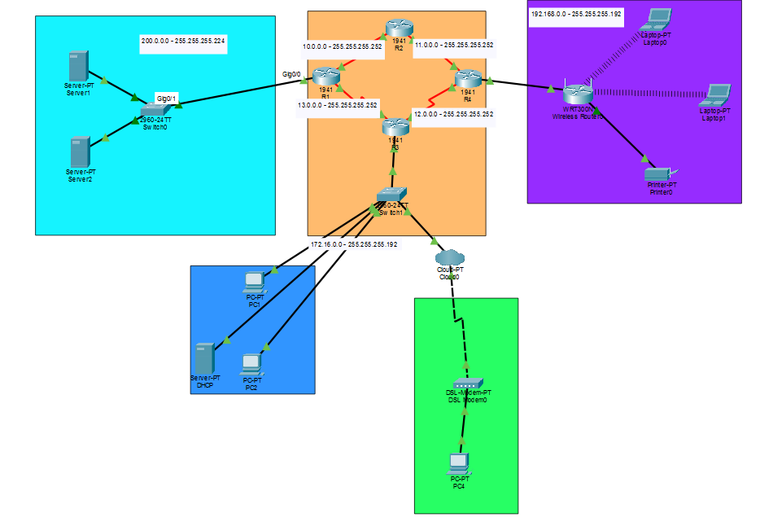
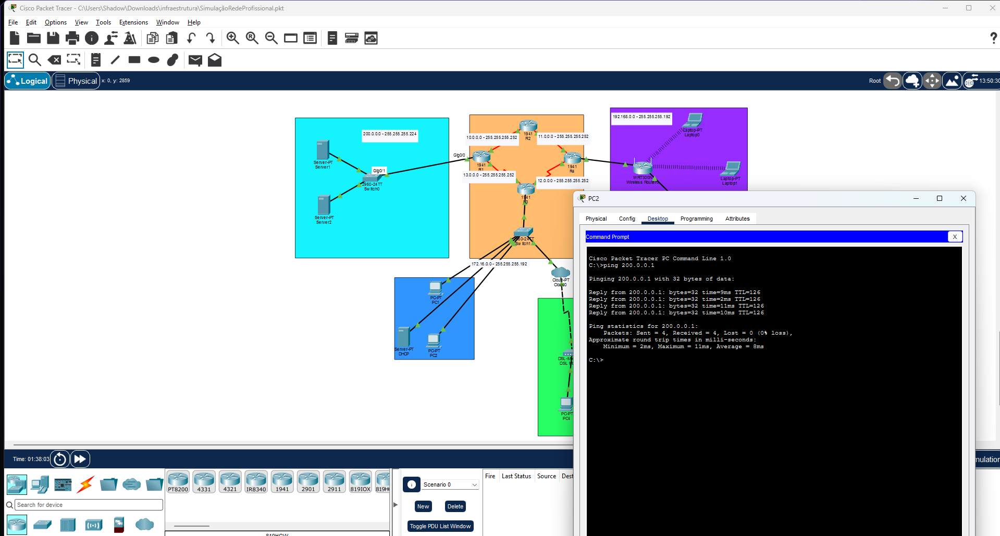
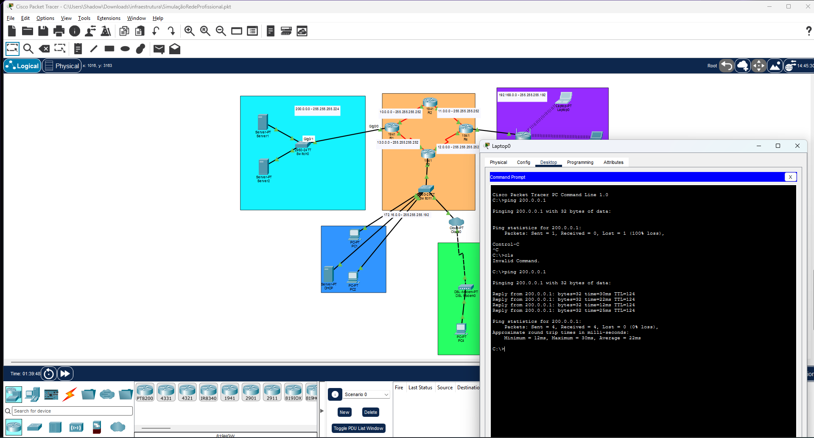
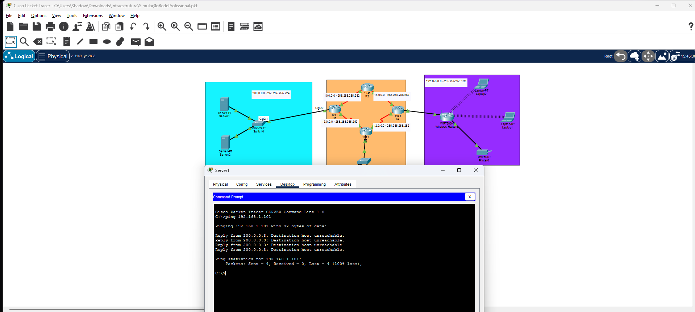

# Topologia de Rede Empresarial

Laboratório desenvolvido no Cisco Packet Tracer para praticar a interligação e o roteamento entre redes locais, servidores, uma rede cabeada, acesso DSL e uma rede Wi-Fi separada por um roteador WRT com NAT.

## Visão geral

## Topologia

A rede usa roteadores para interligar os segmentos e inclui servidores, computadores cabeados, clientes Wi-Fi, impressora, modem DSL e uma nuvem de operadora. O WRT mantém a rede sem fio em uma sub-rede própria: sua interface Internet se conecta à rede principal, enquanto os clientes usam a LAN do WRT.

## Testes de conectividade

- Um computador da rede cabeada alcança o Server1 por ICMP.
- Um notebook conectado ao Wi-Fi alcança o Server1.
- O ping iniciado do segmento dos servidores para um cliente Wi-Fi não completa. O WRT mantém a LAN sem fio atrás de NAT, então ela não é acessível diretamente pela rede principal sem configuração adicional. Conexões iniciadas pelos clientes Wi-Fi podem receber as respostas normalmente.

### Computador cabeado → servidor

### Notebook Wi-Fi → servidor

### Servidor → cliente Wi-Fi

## Arquivos

- [`topologia-rede-empresarial.pkt`](topologia-rede-empresarial.pkt): arquivo para abrir no Cisco Packet Tracer.
- [`LICENSE`](LICENSE): licença MIT para os materiais originais deste repositório.
- `assets/`: capturas dos testes de conectividade.

## Como abrir

1. Baixe ou clone este repositório.
2. Abra `topologia-rede-empresarial.pkt` no Cisco Packet Tracer.
3. Use o modo Simulation ou os terminais dos dispositivos para repetir os testes.

## Conceitos praticados

- Endereçamento IPv4 e sub-redes.
- Interligação de redes por roteadores e rotas estáticas.
- Serviços de rede e testes com ICMP.
- Rede sem fio com roteador WRT, DHCP e NAT.
- Segmentação entre a rede Wi-Fi e os demais segmentos.

> Projeto de estudo para fins educacionais. O comportamento foi simulado no Cisco Packet Tracer e pode diferir de uma rede física.

